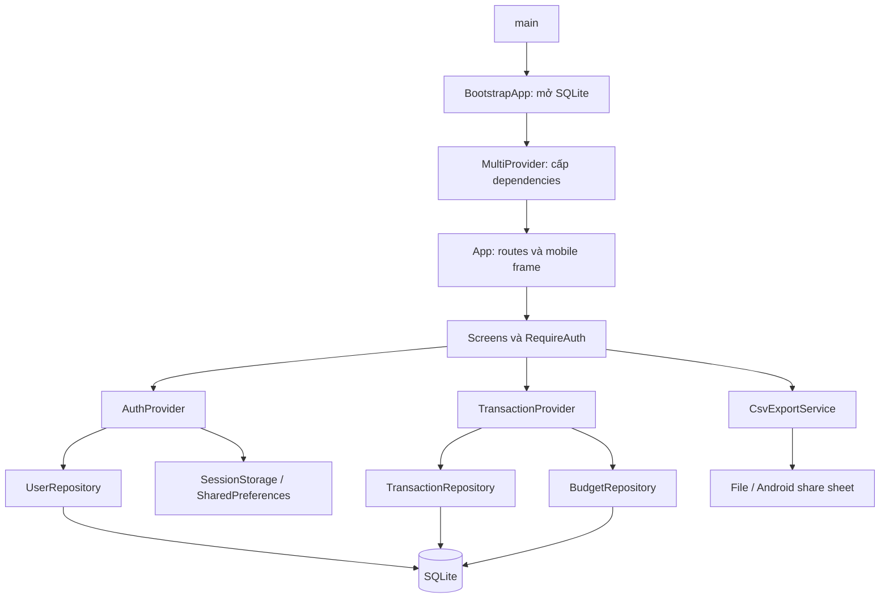
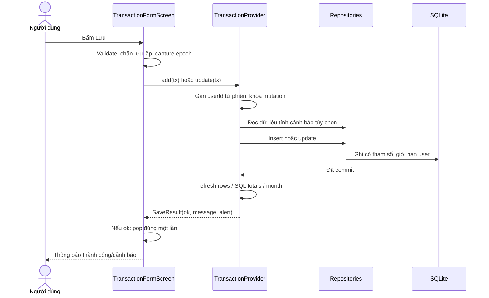

# Lộ trình hiểu và bảo vệ dự án Sổ Thu Chi

Đối chiếu mã nguồn ngày 29/10/2026. Tài liệu này giải thích dự án đang có, không phải đề xuất kiến trúc mới. Bắt đầu từ [dữ liệu trình bày](DEMO_DATA_GUIDE.md); mở [bản đồ method](PROJECT_METHOD_MAP.md) khi cần tra chi tiết một file.

## 1. Kết quả cần đạt

Sau lộ trình, bạn cần tự làm được bốn việc:

1. Từ một thao tác trên UI, chỉ ra screen nào nhận sự kiện, provider nào xử lý, repository nào chạy SQL và UI nào cập nhật.
2. Giải thích nơi lưu dữ liệu, session, state form và state bộ lọc; biết phần nào tồn tại sau khi tắt app.
3. Dự đoán kết quả khi lỗi DB, đổi user trong lúc đang await, nhấp Lưu hai lần hoặc refresh lỗi sau khi ghi thành công.
4. Tự thêm một tình huống nhỏ và xác định đúng chỗ sửa, không đưa SQL vào widget hoặc tự đổi user_id từ form.

Không cần học thuộc mọi dòng `build()`. Cần hiểu trách nhiệm, input/output, trạng thái thay đổi và nơi gọi từng method.

## 2. Kế hoạch bảy buổi

Có thể học trong 2–3 ngày. Mỗi buổi kết thúc bằng một sản phẩm cụ thể để tự kiểm tra.

| Buổi | Thời lượng | Đọc/làm | Sản phẩm phải tự tạo |
|---|---:|---|---|
| 1. Chạy và nhìn nghiệp vụ | 45 phút | Login ba tài khoản demo, xem tổng/tháng, tìm kiếm, xuất CSV; đọc README và DEMO_DATA_GUIDE | Viết một trang: các màn hình và chức năng, phân biệt tổng toàn thời gian với tổng tháng |
| 2. Đường khởi động và dữ liệu | 60 phút | main.dart → bootstrap_app.dart → app.dart; đọc data/models và app_database.dart | Tự vẽ luồng khởi động và ba bảng SQL; giải thích vì sao dữ liệu không mất khi tắt app |
| 3. Repository và SQL | 60 phút | Ba repository, repository_support.dart; tự tính SUM trên bộ demo | Giải thích từng SELECT/INSERT/UPDATE/DELETE, điều kiện user_id và CHECK/UNIQUE/FK |
| 4. Auth, phiên, điều hướng | 60 phút | LoginScreen, SplashScreen, AuthProvider, SessionStorage, RequireAuth, RegisterScreen | Tự kể luồng login/restore/logout/register; chỉ ra nơi duy nhất điều hướng sau logout |
| 5. CRUD và async | 75 phút | TransactionFormScreen, TransactionDetailScreen, TransactionProvider._save/refresh/delete | Vẽ chuỗi bấm Lưu; lập bảng lỗi trước/sau commit; giải thích mounted/epoch/readVersion |
| 6. Search, tháng, budget, CSV | 75 phút | visible, changeMonth, _prepareBudgetAlert, core helpers, CsvExportService | Tự tính 79→80→85→105%; truy ra một dòng CSV từ DB; dự đoán filter có ảnh hưởng tổng không |
| 7. UI, test và bảo vệ | 60 phút | MobileAppFrame, FormFooter, widgets; chạy test; tập demo 15–20 phút | Thuyết trình không nhìn code 5 phút, trả lời câu hỏi mục 10, chạy kịch bản không lệch số |

Nếu chỉ còn một buổi chuẩn bị, ưu tiên các mục 3–6, phần auth của mục 7, rồi tập demo. Dùng bản đồ method để tra thay vì đọc source từ đầu đến cuối.

## 3. Cấu trúc và trách nhiệm

```text
lib/
  main.dart                Điểm vào, binding, SQLite FFI trên desktop, license font
  bootstrap_app.dart       Mở DB bất đồng bộ, loading/retry, khởi tạo dependencies
  app.dart                 Theme, locale, Navigator/named routes, RequireAuth, frame
  core/                    Quy tắc/tiện ích: validate, tiền, ngày, hash, CSV, theme
  data/
    app_database.dart      Đường dẫn SQLite, schema v1, seed demo1/demo2 lần tạo DB
    models/                Cấu trúc dữ liệu, toMap/fromMap, SaveResult
    repositories/          SQL và validation tại biên lưu trữ
    session_storage.dart   userId + timestamp trong SharedPreferences
    csv_export_service.dart Thư mục, file, share sheet và hủy export phiên cũ
  providers/               AuthProvider; TransactionProvider và snapshot/bộ lọc
  screens/                 Nhận tương tác, điều hướng, điều khiển form
  widgets/                 Thành phần giao diện dùng lại
tool/                      Công cụ chủ động nạp dữ liệu trình bày bằng Dart CLI
test/                      Unit, SQLite repository, provider, widget, golden
integration_test/          Kiểm thử tiến trình Windows native với DB tạm riêng
assets/fonts/              Font offline và giấy phép
android/, windows/         Host/build/plugin theo nền tảng
```



Widgets đọc state đã có để vẽ. Provider phối hợp nghiệp vụ và thông báo thay đổi. Repository truy cập SQL. SessionStorage dùng kho key/value riêng, không phải bảng SQLite thứ tư.

### State nằm ở đâu?

| Dữ liệu/state | Nơi giữ | Khi tắt app |
|---|---|---|
| User/hash/salt, giao dịch, ngân sách | SQLite | Còn trên đĩa |
| userId và thời điểm tạo phiên | SharedPreferences | Còn nếu ghi thành công và chưa logout |
| currentUser/isBusy/lỗi auth | AuthProvider | Mất; khôi phục currentUser từ session khi mở lại |
| Snapshot rows/totals, tháng đang chọn, search/filter/sort | TransactionProvider | Mất; đọc lại SQLite, filter trở về mặc định |
| Tab đang chọn | HomeShell State + IndexedStack | Giữ khi chuyển tab, không giữ qua restart |
| Text controller, category/date của form, đang lưu | State của screen | Giữ khi screen còn sống; không tự persist bản nháp |

`setState()` cập nhật state cục bộ của screen. `notifyListeners()` báo các widget đang nghe provider. `context.read<T>()` lấy dependency để gọi method; `watch<T>()`/`Consumer<T>` đăng ký rebuild khi provider đổi.

## 4. Luồng khởi động

1. `main()` gọi `WidgetsFlutterBinding.ensureInitialized()` để plugin sẵn sàng, đăng ký license font.
2. Desktop gọi `sqfliteFfiInit()` và chọn `databaseFactoryFfi`; Android dùng factory sqflite mặc định.
3. `runApp(BootstrapApp())` diễn ra trước khi mở DB xong. `_initialize()` khởi tạo date formatting và gọi `AppDatabase.open()`.
4. FutureBuilder hiển thị loading; lỗi thì có nút Thử lại, không xóa DB hoặc tự tạo lại dữ liệu cũ.
5. `buildInitializedApp()` tạo repository/service/storage và hai provider. `ChangeNotifierProxyProvider` nối auth user vào `TransactionProvider.setUser()`.
6. `App` đặt tiếng Việt, theme và mobile frame, dùng `_route()` tạo named routes. Route đầu `/` là SplashScreen.
7. `SplashScreen._restore()` gọi `restoreSession()`: phiên hợp lệ → Home; không hợp lệ/lỗi đọc → Login.
8. Khi currentUser đổi, proxy gọi `setUser(userId)`, reset state rồi tải dữ liệu của user đó.

Điểm đặt breakpoint: `main`, `AppDatabase.open`, `buildInitializedApp`, `AuthProvider.restoreSession`, `TransactionProvider.setUser`, `TransactionProvider.refresh`. Theo dõi userId, epoch và isLoading; không cần đọc password_hash ra console.

## 5. SQLite và model

| Bảng | Cột chính | Ràng buộc/ý nghĩa |
|---|---|---|
| users | id, username, password_hash, salt, display_name | username UNIQUE; password được hash cùng salt |
| transactions | id, user_id, type, amount, category, date, note, created_at | FK users; type income/expense; 0 < amount ≤ 999999999999; index user/date |
| budgets | id, user_id, month, limit_amount | FK users; UNIQUE(user_id, month); giới hạn tiền giống transaction |

`ON DELETE CASCADE` nghĩa là nếu user bị xóa ở DB thì dữ liệu con bị xóa; UI hiện không có chức năng xóa tài khoản. `PRAGMA foreign_keys = ON` phải bật khi mở connection. Version hiện tại là 1; `_onUpgrade()` là chỗ dành cho migration, chưa có migration thực tế.

`FinanceTransaction` là object Dart; `toMap()` đổi sang tên cột SQL, `fromMap()` đổi Map trả từ SQLite thành object. `copyWith()` tạo bản sao đã đổi một số trường, không mutate object cũ; sentinel cho phép phân biệt “giữ note” và “xóa note bằng null”.

`SummaryTotals.balance` tính `income - expense`; không cần lưu thêm một cột balance có thể bị lệch. `SaveResult` gồm `ok`, `message`, `alert`; `ok` nói về kết quả ghi DB. `BudgetAlert` chứa cấp cảnh báo, số chi và hạn mức.

### SQL cần giải thích được

`getAll(userId)` đọc hàng của một user, xếp `date DESC, id DESC`. ID là tiêu chí phụ khi hai giao dịch cùng ngày. `getById`, `update`, `delete` đều giới hạn cả id và user_id. Update chỉ sửa type/amount/category/date/note, không sửa ownership hoặc created_at.

`getTotals()` dùng SUM/CASE/COALESCE để tính riêng thu/chi; user không có hàng vẫn nhận 0. Có from/to thì thêm khoảng ngày `[đầu tháng, đầu tháng sau)`. `getExpenseByCategory()` thêm type=expense và GROUP BY category.

`BudgetRepository.upsert()` chạy UPDATE theo user/tháng, nếu chưa có thì INSERT trong transaction. Cách này giữ ID khi cập nhật và không phụ thuộc cú pháp UPSERT mới trên Android cũ.

Mỗi repository gọi `runDatabaseOperation()`. Lỗi SQLite được log phục vụ debug rồi chuyển thành AppException tiếng Việt; người dùng không thấy SQL/stack trace thô. Validation ở form phục vụ UX; repository kiểm tra lại để dữ liệu ghi từ đường khác vẫn tuân thủ quy tắc.

## 6. Luồng Lưu — phần cần nắm chắc nhất



Đọc `TransactionFormScreen._save()` rồi `TransactionProvider._save()` theo thứ tự:

1. Form từ chối nếu `_isSaving`, `_didSave` hoặc validate không đạt. Đặt cờ lưu **trước await**.
2. Form capture `userEpoch`, tạo transaction. userId trong form là placeholder; provider luôn thay bằng userId của phiên đã capture.
3. Provider từ chối khi chưa login/đang mutation; đặt `_isSaving`, chuẩn bị cảnh báo nếu là khoản chi.
4. Repository validate và ghi. Khi await ghi trả về thành công, `committed = true`.
5. Provider đọc lại rows, tổng SQL và dữ liệu tháng. Các kết quả được công bố cùng nhau sau khi đọc đủ. Đây là cách công bố state UI; các query đọc hiện chạy lần lượt, không phải một transaction SQL duy nhất.
6. Ghi lỗi → `ok=false`, form giữ input. Ghi thành công → `ok=true`; refresh lỗi sau đó chỉ là warning, form vẫn đóng để tránh người dùng lưu trùng.
7. Sau mỗi await quan trọng, kiểm tra mounted/epoch/version theo lớp trách nhiệm. Cờ của phiên cũ không được reset cờ của phiên mới.

| Tình huống | Kết quả ghi | Hành vi UI |
|---|---|---|
| Tiền 0, thiếu category | Chưa ghi | Inline error |
| Repository/SQLite từ chối ghi | Không commit | Form giữ nguyên, hiện lỗi |
| Đã insert nhưng refresh lỗi | Đã commit | Form đóng, cảnh báo cần tải lại; retry chỉ đọc |
| Logout/đổi user trong lúc await | Tác vụ cũ có thể đã ghi cho đúng user cũ | Không điều hướng/thông báo/ghi state của phiên mới |
| Bấm Lưu hai lần | Guard bỏ lần lặp | Một write của lần đầu |

`mounted` chỉ nói screen còn tồn tại. `epoch` nói vẫn cùng phiên user. `_readVersion` phân biệt hai lượt refresh của cùng user; `_monthReadVersion` phân biệt hai lựa chọn tháng. Bốn việc này giải quyết các điều kiện khác nhau.

### Detail và Delete

Detail nhận id và đọc `provider.byId(id)`, nên sau sửa sẽ hiện dữ liệu mới. `_edit()` push form với bản ghi initial. `_delete()` xác nhận rồi await provider.delete; nếu thành công pop một lần. `_scheduleMissingClose()` chỉ tự đóng khi một lần tải thành công xác nhận bản ghi không còn; không suy luận “đã xóa” từ trạng thái đang tải hoặc lỗi DB.

## 7. Auth, session và route guard

**Login:** `_login()` → `AuthProvider.login(username,password)` → `UserRepository.authenticate()`. Username trim/lowercase; repository đọc salt/hash và gọi PasswordHasher.verify. Hợp lệ thì `SessionStorage.save(id)` và gán currentUser; screen xóa stack cũ để vào Home. Sai thì banner chung, giữ username và xóa password.

**Restore:** SessionStorage.read lấy hai key `session_user_id` và `session_created_at_ms`. AuthProvider kiểm tra timestamp tương lai, tuổi **>=7 ngày** và user còn tồn tại. Phiên sai thì clear; lỗi đọc storage thì Login với thông báo, không tự xóa một phiên có thể còn hợp lệ.

**Logout:** HomeShell chỉ xác nhận và gọi `AuthProvider.logout()`. Provider xóa key rồi currentUser=null. Proxy reset TransactionProvider; RequireAuth của route đang hiện chuyển Login và xóa stack. HomeShell không tự push Login thêm lần nữa. Nếu xóa session lỗi, currentUser còn và app hiện lỗi để thử lại.

**Register:** validate → UserRepository.register ghi hash/salt → lưu session → tự vào Home. Trùng username là lỗi tại field. Nếu đã tạo user nhưng ghi session lỗi, `registrationCreated` cho biết tài khoản đã tồn tại; UI hướng dẫn đăng nhập, không đăng ký thêm lần nữa.

**Bảo vệ:** `_route()` bọc Home, transaction new/edit/detail và budget bằng RequireAuth. Guard kiểm tra khi build và điều hướng sau frame, chỉ khi route đó hiện tại; route phía dưới stack không cùng redirect.

PasswordHasher dùng SHA-256 của chuỗi `salt:password`, với salt ngẫu nhiên riêng. Cách này đáp ứng phạm vi bài không lưu plaintext; SHA-256 nhanh và không nên trình bày như giải pháp password hashing cho sản phẩm thực tế. Cách ly user_id/session local không thay thế kiểm soát truy cập trên một server hoặc bảo vệ thiết bị bị can thiệp.

## 8. Search, sort, tháng, ngân sách, CSV

### Search/filter/sort

Search có debounce 300 ms trong screen; Timer được hủy khi thay query/dispose/đổi phiên. `visible` lọc từ `_all` trong Dart theo AND: loại đúng, category đúng, query khớp category hoặc note đã normalize. normalizeVi lowercase, bỏ dấu dựng sẵn và dấu tổ hợp. Bốn sort có tiêu chí phụ ổn định bằng ngày/id.

Tổng SQL không tính từ visible nên filter không đổi tổng. Filter lưu ở TransactionProvider; IndexedStack giữ tab screen. Logout/login reset filter qua setUser. `categoryOptions` phụ thuộc type; đổi type chỉ xóa category khi category cũ không còn hợp lệ.

### Tháng

`monthKey` tạo yyyy-MM; `monthRange` trả đầu tháng và đầu tháng sau. `changeMonth(delta)` chặn tương lai/trước năm 2000; chỉ thay phần tháng. `hasMonthData` so tháng của snapshot với tháng đang chọn, tránh gắn nhãn tháng mới lên dữ liệu cũ khi đang await.

### Ngân sách

`budgetLevel`: <80% → null; từ 80% tới đúng 100% → warning; **>100%** → exceeded. `calculateBudgetAlert` so cấp trước/sau, chỉ trả alert nếu cấp tăng. Dashboard có thể luôn hiển thị warning nhưng không có nghĩa mọi lần refresh đều phải phát SnackBar.

Khi sửa khoản chi trong cùng tháng: `afterSpent = beforeSpent - oldAmount + newAmount`. Đổi tháng hoặc đổi từ Thu sang Chi thì cách xác định oldAmount khác; đọc code `_prepareBudgetAlert` và test ngân sách để giải thích. Tính cảnh báo là đọc tùy chọn: lỗi đọc này không chặn một lần ghi hợp lệ.

BudgetScreen._submit gọi saveBudget/removeBudget. Provider `_writeBudget()` ghi rồi refresh; lỗi ghi được throw, refresh lỗi sau commit được giữ thành warning. Screen đóng sau ghi thành công, không yêu cầu lưu lại.

### CSV

`HomeShell._exportCsv` capture epoch → `TransactionProvider.buildCsv` đọc **toàn bộ** giao dịch user → `buildTransactionsCsv` sắp ngày tăng dần, header/BOM, escape các ô → `CsvExportService.export` ghi file/chia sẻ.

Windows lưu Downloads hoặc Documents; Android tạo file tạm và mở share sheet. Service kiểm tra isCurrent quanh các await; đổi user thì bỏ export cũ, dọn file dở nếu đã ghi. Export không gửi dữ liệu qua mạng trong mã nguồn của app. Android share sheet là thao tác riêng cần kiểm tra trên thiết bị.

## 9. UI và kiểm thử

`MobileAppFrame` nằm trong MaterialApp.builder nên bao toàn Navigator, bao gồm menu/dialog/date picker. Windows đủ rộng/cao: viewport 430 dp, viền 8 dp, chiều cao vừa cửa sổ tối đa 900 dp nội dung. Cửa sổ hẹp/điện thoại dùng viewport thật. Cấu trúc cây giữ ổn định khi resize nên Navigator/input không bị tạo lại.

`ResponsiveBody` quản lý safe area/max-width. `SummaryPair`, FilterBar và AdaptiveTransactionFields dùng local constraints/text scale để xếp dọc khi cần. `FormFooter` là bottom bar tránh keyboard; SnackBar nằm phía trên. DashboardSkeleton chỉ xuất hiện khi chưa có snapshot lần đầu, không dùng số 0 giả cho loading.

| Loại test | Học được gì | Nên mở |
|---|---|---|
| Hàm thuần | Input/output, biên ngày/tiền, Unicode, CSV, mức cảnh báo | validators_test, text_utils_test, budget_test, csv_export_test |
| Repository SQLite | SQL thật, ràng buộc, ownership, persistence | transaction_repository_test, database_persistence_test, database_error_test |
| Auth/session/provider | State async, clock giả, kết quả cũ, commit/refresh | auth_provider_test, session_storage_test, transaction_provider_test, month_dashboard_test |
| Widget | Tương tác form, route, double tap, thông báo, layout | transaction_form_test, mobile_layout_test, ui_upgrade_test, budget_screen_test, registration_test |
| Golden | So sánh ảnh widget/font/fixture | mobile_layout_test và test/goldens |
| Native integration | Windows process + SQLite tạm, thao tác UI, CSV | integration_test/windows_smoke_test.dart |
| Công cụ demo | Không trùng/ghi đè dữ liệu cũ, backup, rollback, số baseline | demo_data_test.dart |

Chạy ở root:

```powershell
flutter analyze
flutter test --reporter expanded
flutter test test/demo_data_test.dart --reporter expanded
flutter test integration_test/windows_smoke_test.dart -d windows
```

Golden dùng fixture; native test dùng DB tạm và session memory; tool seed là thao tác chủ động vào DB trình bày. Không nhầm ba nguồn này. Xem TEST_RESULTS cho bằng chứng đã chạy; restart tiến trình thật và share sheet Android có quy trình riêng.

## 10. Câu hỏi bảo vệ và ý trả lời

| Câu hỏi | Ý trả lời cần nói được |
|---|---|
| Vì sao dùng SQLite? | App offline, dữ liệu local bền, không cần server; phù hợp phạm vi môn học |
| Vì sao cần FFI? | Windows dùng triển khai SQLite qua FFI, Android có sqflite; repository dùng cùng interface |
| Provider khác repository thế nào? | Provider giữ/điều phối state và thông báo UI; repository chạy truy vấn/ghi dữ liệu |
| Khi nào dữ liệu lưu thật? | Khi insert/update/delete hoàn thành commit, không phải khi widget rebuild |
| AppBar tổng lấy từ danh sách đã lọc? | Không; SQL totals theo user, bộ lọc chỉ ảnh hưởng visible |
| Vì sao không lưu balance vào DB? | Balance được suy ra từ income−expense, tránh giá trị dư thừa bị lệch |
| Tắt app rồi đăng nhập lại thế nào? | Preferences chứa userId/time, restore kiểm tra hạn và đọc user; password không được lưu trong session |
| Tại sao query có user_id dù đã login? | Login là state UI; từng truy vấn vẫn cần ownership để không đọc/ghi nhầm user |
| mounted đã đủ chưa? | Chưa; widget còn sống nhưng user có thể đổi, nên cần epoch |
| Epoch và readVersion khác nhau? | Epoch đổi theo user; readVersion ngăn lượt đọc cũ của cùng user ghi đè lượt mới |
| Vì sao setUser dùng microtask? | Nó được gọi trong proxy update lúc build; reset im lặng trước, notify/refresh sau để tránh notify ngay giữa build |
| Lưu thành công nhưng refresh lỗi? | ok=true, form đóng; cảnh báo tải lại chỉ đọc, không lặp insert |
| Nhấp Lưu hai lần? | Cờ trong screen và provider đặt trước await, bỏ lần lặp |
| Có cho đổi loại khi sửa? | Có; reset category trong form, repository kiểm tra category đúng type |
| Date lưu sao và chọn tháng sao? | yyyy-MM-dd; khoảng đầu tháng ≤ date < đầu tháng sau; ISO canonical cho so sánh TEXT |
| Đúng 100% có vượt không? | Chưa; warning tới 100%, exceeded khi >100% |
| Sửa expense tính cảnh báo thế nào? | Trừ giá trị cũ trong cùng tháng trước khi cộng mới; so mức trước/sau |
| Vì sao UPDATE rồi INSERT budget? | Upsert trong transaction, giữ ID và tương thích SQLite Android cũ |
| CSV đang lọc có chỉ xuất vài hàng? | Không; buildCsv đọc lại toàn bộ rows của user, BOM/escape/guard ở hàm thuần |
| Có bảo mật tuyệt đối không? | Không; local session và SHA-256 có giới hạn, không có server hoặc mã hóa DB |
| Test 10 lỗi kết nối mạng? | Đề áp dụng Firebase/REST; app SQLite N/A, lỗi lưu trữ SQLite có test riêng |
| Khung Windows có thay app Android không? | Chung code UI/logic; Windows có khung minh họa, Android dùng safe areas/keyboard thật và vẫn cần test thiết bị |

## 11. Bài tập tự kiểm tra và đáp án

1. **Thêm 100.000 Chi từ baseline presenter:** chi tháng thành 8.000.000; chi toàn thời gian 28.400.000; số dư 29.100.000; warning 80%.
2. **Tìm `ca phe`:** tìm được ghi chú có dấu dựng sẵn và dấu tổ hợp; tổng toàn thời gian không đổi. Tự chỉ ra nơi normalize category/note/query.
3. **Đổi tháng 10 sang 9:** chi tháng 9.600.000, budget 10.000.000; all-time chi vẫn 28.300.000 khi chưa CRUD.
4. **Sửa dòng đang là Thu sang Chi:** category ban đầu bị reset; phải chọn lại category Chi; provider lấy userId từ phiên.
5. **Lượt đọc A về sau khi login B:** epoch khác nên không publish kết quả, không hiện lỗi của A lên B.
6. **Lưu DB xong nhưng SQL read sau đó lỗi:** SaveResult.ok vẫn true, form đóng; giữ warning/needsRefresh và retry chỉ đọc.
7. **Muốn thêm danh mục mới:** xem categories.dart, appearance map và các test/seed liên quan; không tạo SQL table mới chỉ vì danh mục là danh sách cố định. Xem xét dữ liệu cũ trước khi thay tên một danh mục đang được lưu.
8. **Muốn thêm phương thức thanh toán:** cần thiết kế field/model, schema migration tăng version, repo/form/detail/CSV/validation/test; không chỉ thêm một ô TextField.

Trước khi bảo vệ, tự trình bày một chuỗi hoàn chỉnh: “Người dùng bấm Lưu → screen validate và khóa nút → provider gắn userId/tính cảnh báo → repository ghi SQLite → refresh SQL totals → notifyListeners → Consumer rebuild → form đóng theo SaveResult”. Nếu giải thích được cả nhánh lỗi trước/sau commit và nhánh đổi user, bạn đã nắm phần khó nhất của dự án.
