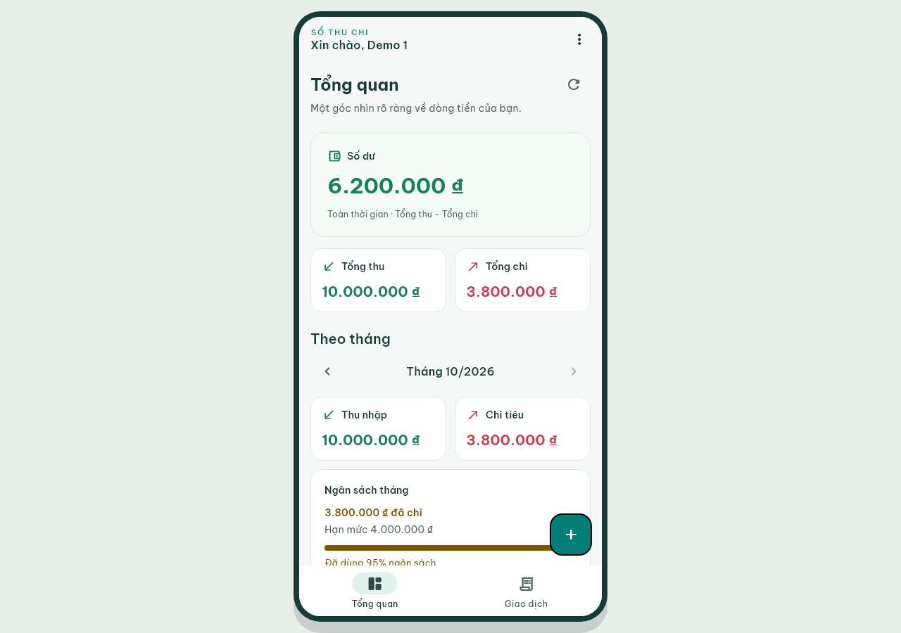

# Thiết kế mobile và kế hoạch nghiệm thu — Sổ Thu Chi

Cập nhật 29/10/2026 theo yêu cầu chủ dự án: phát triển trên Windows nhưng thiết kế cho môn mobile app. Hướng khung điện thoại thay thế đề xuất dashboard desktop rộng/NavigationRail trước đó.

## Bản nâng cấp UI mới đã áp dụng

Đã đọc bản người dùng cung cấp tại `C:\Users\Admin\.gemini\antigravity\brain\9d660918-1e78-43ab-b6f7-32eaf46be654\ui-upgrade-plan.md`. Bảng dưới ghi phần đã triển khai vào mã nguồn; file kế hoạch gốc được giữ nguyên.

| Nhóm | Kết quả triển khai |
|---|---|
| U1 — nền tảng | TextTheme đầy đủ bằng Be Vietnam Pro; AppSpacing 4/8/16/24/32, radius control/card/balance 12/16/20; token surfaceCard/onCard |
| U2 — màn hình | Login có form card, banner lỗi trong form và demo riêng; dashboard có skeleton lần tải đầu; danh sách có dropdown Sắp xếp, số kết quả và chip bỏ từng điều kiện |
| U2 — form/detail/budget | Tiền nhập rõ hơn, helper VND; category/ngày cạnh nhau khi vùng nội dung ≥420 dp và chữ không lớn; detail có nút Sửa trên AppBar, khối metadata và nút Xóa riêng; budget có banner nhắc 80% |
| U3 — thành phần | Icon danh mục có nền pastel riêng; tile có hover/focus/splash; empty state gọn; AppBar có bóng nhẹ khi nội dung cuộn |
| U4 — thích ứng | Tiếp tục khung mobile 430 dp và bottom navigation theo yêu cầu trước của chủ dự án. Không áp dụng đề xuất NavigationRail/dashboard 1120 dp trong bản mới vì trái với yêu cầu khung mobile |
| U5 — kiểm chứng | Thêm test lỗi login inline, skeleton không hiện tổng 0 giả, chip/sort giữ state độc lập, form thích ứng và detail chữ 1×/2×; cập nhật 8 ảnh golden |

Không thêm nhóm giao dịch theo ngày vì kế hoạch xếp phần đó vào giai đoạn sau. Hover mới bỏ thời gian chuyển khi hệ thống yêu cầu giảm chuyển động; skeleton tĩnh không dùng animation lặp.

## Thiết kế đã triển khai

- Material 3 sáng, teal nhận diện; xanh cho thu, đỏ cho chi; luôn kèm nhãn/dấu, không chỉ dựa vào màu.
- Be Vietnam Pro 400/500/600/700 bundle offline; kèm OFL và đăng ký license trong ứng dụng.
- Số dư là thẻ chính, Tổng thu/Tổng chi hỗ trợ. Số tiền dài/chữ lớn chuyển bố cục thay cho thu nhỏ vô hạn.
- Icon riêng cho danh mục, số tiền căn phải và ghi chú/ngày có thứ bậc rõ.
- Thống kê tháng và ngân sách có vùng riêng; ba tổng chính luôn toàn thời gian.
- Form giao dịch/ngân sách có footer Lưu/Hủy, bố trí tránh bàn phím và SnackBar. Xóa ngân sách/giao dịch cần xác nhận.
- Đăng ký có validation/tên trùng; menu CSV chỉ xuất hiện trên tab Giao dịch.

## Khung Windows và responsive

| Trường hợp | Hành vi thực tế |
|---|---|
| Desktop rộng ≥600 dp, cao ≥440 dp | Khung có viền 8 dp, viewport nội dung 430 dp; chiều cao vừa cửa sổ, tối đa 900 dp |
| Cửa sổ nhỏ hoặc thấp | Dùng toàn viewport, cuộn nội dung; không ép một khung cao vượt màn hình |
| Android | Dùng toàn chiều rộng, giữ safe areas và keyboard insets thật |
| Mọi kích thước | Hai tab dưới cùng, cùng Navigator, không đổi sang rail |
| Dialog/menu/date picker | Thuộc Navigator bên trong khung, không mở tràn cửa sổ desktop |
| Resize qua breakpoint | Giữ route, input và state tab/filter |

`MobileAppFrame` nằm trong `MaterialApp.builder`, bao cả bootstrap và Navigator. `ResponsiveBody` giữ max-width 640 cho nội dung trên thiết bị lớn không có frame. Không khóa xoay màn hình hoặc text scaling; không dựng status bar/giờ thiết bị giả.

## M7–M10

| Mốc | Kết quả |
|---|---|
| M7 | MonthSelector, SQL month totals, CategoryBreakdown; chặn kết quả truy vấn tháng cũ và không đổi tổng toàn thời gian |
| M8 | BudgetScreen/Progress, upsert giữ ID, giới hạn số tiền, cảnh báo tăng cấp 80%/>100%; lỗi refresh sau commit không yêu cầu lưu lại |
| M9 | Đăng ký/tự đăng nhập, hash/salt, lỗi username trùng tại field; xử lý tạo user thành công nhưng lưu phiên lỗi |
| M10 | Hàm CSV thuần có BOM/escaping/order, đọc theo user; file Windows hoặc share sheet Android, kiểm tra epoch và dọn export dở |

Schema vẫn v1, dùng SQLite duy nhất. App không tự seed giao dịch. Theo yêu cầu chuẩn bị thuyết trình ngày 29/10/2026, công cụ CLI riêng đã backup và nạp dữ liệu vào ba tài khoản trình bày trong DB Windows; xem DEMO_DATA_GUIDE.md. Những fixture trong ảnh golden vẫn chỉ thuộc test.

## Ảnh kiểm tra

Ảnh từ widget thật, font bundle và fixture cố định:

- [Danh sách](test/goldens/windows_mobile_list.png)
- [Form](test/goldens/windows_mobile_form.png)
- [Ngân sách](test/goldens/windows_mobile_budget.png)
- [Đăng ký](test/goldens/windows_mobile_register.png)
- [Đăng nhập](test/goldens/windows_mobile_login.png)
- [Lỗi đăng nhập](test/goldens/windows_mobile_login_error.png)
- [Chi tiết](test/goldens/windows_mobile_detail.png)

Ảnh từ tiến trình Windows native trong integration test dùng SQLite tạm riêng: [Dashboard](evidence/native/windows-dashboard.png), [Danh sách](evidence/native/windows-list.png), [Đăng nhập](evidence/native/windows-login.png). Số liệu ở bộ ảnh native khác fixture golden, vì native tạo khoản chi 900 đồng để kiểm tra ngưỡng 900/1000.

Hai file `design-system/so-thu-chi/visual-direction.svg/png` là phác thảo desktop cũ, được giữ làm lịch sử và không còn là thiết kế để triển khai.

## Nghiệm thu tự động đã có

- 120 unit/repository/provider/widget/golden/tool tests qua; xem evidence/tests.txt (gồm 6 test mới của công cụ demo).
- Một integration test Windows native qua: login lỗi inline/nhập lại, khung 430 dp, ngân sách, thêm giao dịch, detail/action Sửa, cảnh báo 90%, tổng tháng, CSV BOM, đóng/mở lại file DB; bảy ảnh native được chụp lại với UI mới.
- APK Android debug đã build thành công; UI và share sheet trên thiết bị chưa được kiểm tra.
- Responsive ở 360×640, 412×915, 768×1024, 1280×720, 1440×900, landscape 844×390; text scale 1×/2×.
- Resize không mất route/input; date picker ở trong khung; nút Lưu và thông báo không đè nhau khi có keyboard inset.
- Form qua kiểm tra label và Android touch targets của Flutter. Đây chưa phải chứng nhận accessibility cho toàn ứng dụng.

## Các bước nghiệm thu còn lại

1. Kiểm tra bản Android trên emulator/thiết bị: bàn phím thật, safe areas, xoay màn hình và share sheet CSV.
2. Quay video Windows: đăng nhập → đóng tiến trình → tự đăng nhập; logout → đóng/mở → cần đăng nhập; đổi demo1/demo2 hai chiều.
3. Chạy bundle Release ở cwd khác để xác nhận đường dẫn DB/session và các DLL đóng gói trong tiến trình release.
4. Kiểm tra Windows display scale 100/125/150% bằng thao tác native; text scaling tự động không thay cho toàn bộ kiểm tra display scale.
5. Cập nhật từng dòng TEST_RESULTS/SCREENSHOTS bằng bằng chứng thật. Không chuyển các bước chưa chạy thành Pass.

Nguồn hướng dẫn thiết kế đã đọc: skill `.codex/skills/ui-ux-pro-max/SKILL.md`, [Flutter responsive](https://docs.flutter.dev/ui/adaptive-responsive/general), [Flutter accessibility](https://docs.flutter.dev/ui/accessibility), [W3C contrast](https://www.w3.org/WAI/WCAG22/Understanding/contrast-minimum). Hướng landing page/marketing do tìm kiếm skill gợi ý không được dùng làm bố cục ứng dụng này.
